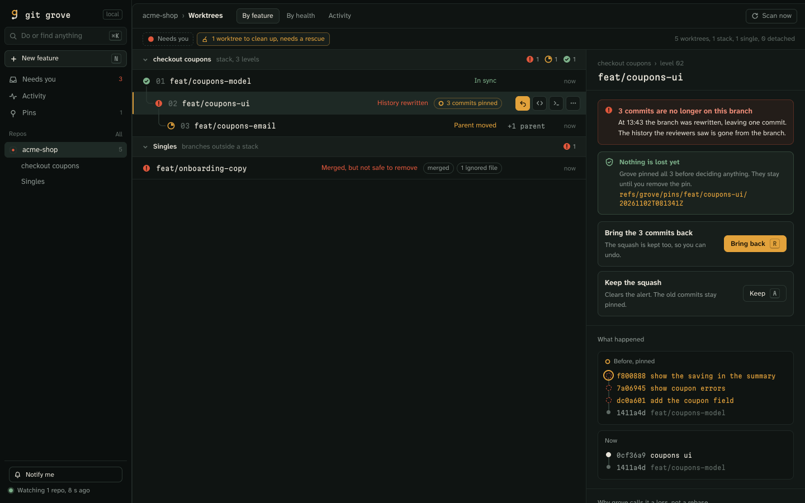
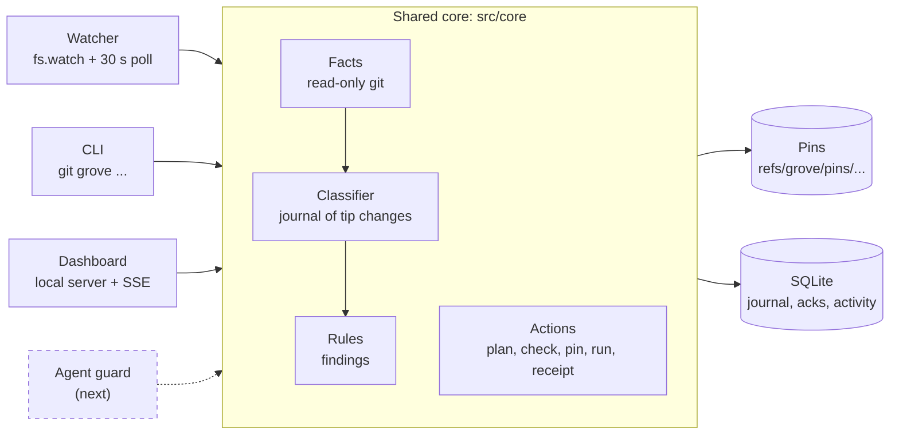
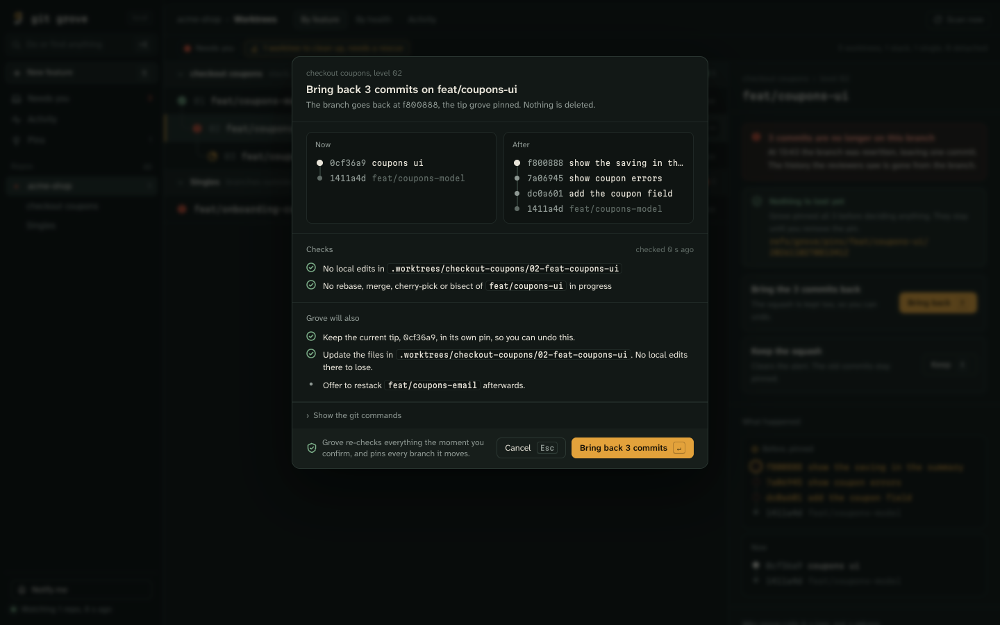
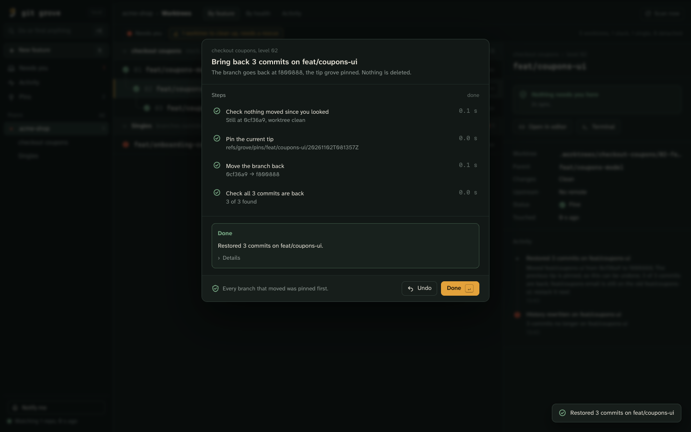

# git-grove

On a client project I keep 4–10 git worktrees open, several with AI coding agents in them, and ship features as
stacks of small PRs. In two months three things went wrong, and git reported success each time: a stack branch went
from 16 commits to 1 in a rebase nobody meant to run; an agent's cleanup of merged worktrees deleted ignored files
that existed only there; and a stacking tool came one command away from force-pushing other features' branches.
While designing this I reproduced a fourth: a plain `git worktree remove` of one level deletes a nested level's
uncommitted file with it. git-grove watches every worktree and stack, pins each branch tip it sees replaced, tells a
rebase from a squash, and refuses to remove a worktree that holds the only copy of something.



## Try it in two minutes

```sh
pnpm install && pnpm build && pnpm demo
```

`scripts/demo.sh` builds a throwaway repository with a three-level stack in a temp folder. It squashes one level the
way an agent might, and leaves a merged worktree holding the only copy of an ignored `.local/seed.sql`. Then
`git grove status` reports both, `git grove check remove` refuses the worktree with exit 3, and `restore` and
`rm --rescue` put things right. The demo uses its own temp `GIT_GROVE_HOME`, `HOME` and git config, installs nothing
and needs no network. At the end it prints how to open the dashboard on the same repository.

## Install

git-grove is not on npm yet. From a clone of this repository:

```sh
pnpm install && pnpm build && npm link
git grove status
```

`npm link` puts the `git-grove` bin on your `PATH`, and git runs it as `git grove`. Once the package is published,
`npx git-grove status` will run it without installing, and `npm i -g git-grove` will install it.

## How it works



There are four ways in, and three are built: the watcher inside the dashboard server, the CLI and the dashboard.
The agent guard is next. All of them call the same core, so the CLI and the dashboard cannot disagree.

- Facts are what git says, read with `--no-optional-locks`: worktrees, branch tips, gh-stack's stack config,
  stashes, pins and each worktree's status.
- The classifier compares every branch tip with the last one it journaled. A move that is not a fast-forward pins
  the old tip first, then matches the branch's own commits by patch ID, then by author, date and subject, and calls
  the move amended, rebased or rewritten. Only a rewrite alerts.
- Rules turn facts and the journal into findings, worst first. That is "Needs you" in `status` and the dashboard.
- Actions show a plan first. Running one re-checks what the plan read, pins every tip it will move, and returns a
  receipt with an undo where one exists.

Pins are git refs (`refs/grove/pins/<branch>/<UTC time>`), so they outlive grove's database. The journal,
acknowledgements and activity are in SQLite at `~/.git-grove/grove.db`. Previewed plans live in the server's memory
for 10 minutes. [`docs/submission.md`](docs/submission.md) explains the design and its tradeoffs, and the full spec,
including what was cut, is [`docs/superpowers/specs/2026-11-01-git-grove-design.md`](docs/superpowers/specs/2026-11-01-git-grove-design.md).

## The dashboard

```sh
git grove        # the same as: git grove ui
```

`git grove ui` adds the repository you are in, makes sure the dashboard server is running, and opens it in your
browser at the feature of the worktree you are in. Outside a repository it opens the list of repositories. With
`GIT_GROVE_NO_OPEN=1` it prints the address instead of opening it.

The first time, `ui` installs a login service, so the dashboard is there whenever you are logged in:

- macOS: a launchd agent, `~/Library/LaunchAgents/work.grove.server.plist`
- Linux: a systemd user unit, `~/.config/systemd/user/git-grove.service`

The service runs `node <git-grove>/dist/cli/bin.js serve`, starts it again if it fails, and appends its output to
`~/.git-grove/server.log`, which moves to `server.log.1` when the server starts and finds it over 5 MB. `ui` prints
the file it wrote; `git grove service uninstall` unloads it and deletes that file. `npm install` never installs it.
When you update git grove, the next `git grove ui` asks the older server to exit, and the service starts the new
version. When the service runs another copy of git grove, another grove folder, or a Node that is no longer there,
`ui` rewrites it to run this one and says so; run from `npx`, it leaves the service alone and opens its server.

```sh
git grove service install     # write and load the login service
git grove service uninstall   # unload it and delete its file
git grove service status      # whether it is installed and loaded, and where the dashboard runs
git grove serve [--port <n>]  # run the server in this terminal instead, until Ctrl-C
```

Where there is no launchd or systemd user session (a container, or SSH without a user bus), or when git grove runs
from an `npx` cache, `ui` serves in the foreground until Ctrl-C, and `service install` says why and exits 1 without
writing anything.

Every dashboard action that changes git opens a review first: the checks grove ran, what it will also do, and the
exact git commands. The confirm button arms 400 ms after the plan appears, and a held key never confirms. While it
runs you see each step, then a receipt with Undo, which opens the undo as a new review.





### As an app

Chrome and Edge offer "Install git grove" in the address bar, which gives the dashboard its own window and dock icon.
"Notify me" in the sidebar turns on system notifications for changes that lose work, while the dashboard is open.

### Security

- The server listens only on `127.0.0.1` and `[::1]`, and answers only a `Host` of `127.0.0.1`, `[::1]` or `localhost` with its port.
- Every API and event request needs the token in `~/.git-grove/token` as an `X-Grove-Token` header. `ui` hands it to the page in the URL's fragment, which is never sent over the network, and the page keeps it in that port's `localStorage`. There is no cookie and no CORS.
- Known limits, accepted on a single-user machine:
  - a program that later listens on a port git grove has served on can read that port's `localStorage`, and with it the token; that is every port grove has served on, up to 20 (47683 to 47702);
  - while the browser opens, the dashboard's address, token included, is briefly visible in the process list to other local users;
  - an installed dashboard app is tied to the port it was installed on, so if git grove moved to another port, run `git grove ui` again;
  - notifications need an open dashboard tab or window;
  - the first address `ui` opens carries the token in its fragment, which may stay in the browser's history;
  - `new --install` keeps the repository's lock while dependencies install, so other actions in that repository
    wait and the dashboard pauses its scans of it until the install ends.

## Commands

```sh
git grove status [--json]                    # what needs you, then one line per worktree
git grove restore <branch> [<pin-ref>]       # move a branch back to the pin its alert names, pinning its current tip first
git grove ack <branch>                       # mark a branch's rewrite or deletion as intended
git grove pins list [<branch>]               # list pins, newest first
git grove check remove <worktree> [--json]   # exit 0 when safe to delete, 3 when not
git grove new <feature> [--branch <b>]       # start a feature: level 01 on the trunk, in .worktrees/<feature>/01-<branch>
git grove add-level <feature> <branch>       # add the next level on the deepest one, or on --on <parent-branch>
git grove restack <feature> [--stash]        # move each level of a stack onto its parent, pinning every tip first
git grove stack plan <feature> [--json]      # show what restack would do, changing nothing
git grove rm <worktree> [--rescue]           # remove a worktree's folder when nothing would be lost, keeping its branch
```

`new` and `add-level` copy the main worktree's env files into the new level (`--skip-env` to skip), and take
`--install` to install dependencies and `--open` to open it in your editor. `rm --rescue` first copies the ignored
files only that worktree has into the main worktree, and checks the copies. `new`, `add-level`, `restack` and `rm`
show their plan and change nothing with `--dry-run`, and print JSON with `--json`. `restore` and `ack` print their
plan, each step and the receipt too, through the same core the dashboard uses. With no open alert to say which pin
you mean, `restore` lists the branch's pins and asks you to name one. No command pushes.

For example, after an agent squashes `feat/coupons-ui` into one commit:

```sh
git grove status                                   # History rewritten: 3 commits no longer on feat/coupons-ui
git grove restore feat/coupons-ui                  # the three commits are back (or: git grove ack feat/coupons-ui)
git grove check remove .worktrees/old-onboarding   # lists .local/seed.sql and exits 3
git grove rm --rescue .worktrees/old-onboarding    # copies .local/seed.sql into main, then removes the folder
```

`status` journals tip changes from one run to the next, so the first run in a repository only records where every
branch is. Errors print one line on stderr and exit 1; an action blocked by what its plan found exits 3.

## Not yet

- The agent guard: a Claude Code `PreToolUse` hook that would stop `git worktree remove --force` and similar
  commands before they run. The verdict it would ask for is built and runs as `git grove check remove`; the hook and
  its command parser are not. It was planned for the slice after the dashboard, and the dashboard took the time.
- Reflog catch-up. A change made while grove was not running is found at the next scan as one move, from the last tip
  grove saved to the current one, and is pinned and classified like any other. The steps in between are not read
  from the reflog, a branch grove never saw has nothing to compare, and an old tip git has already pruned is
  replaced without an entry. The login service keeps the scanner running, so this was the gap to leave.
- GitHub data: PR state and review threads. "Merged" is decided from git alone. It needs `gh` and rate-limit
  handling, and sat below the spec's cut line.
- A `git grove demo` command. `scripts/demo.sh` does the same from a clone, and a script was quicker to build.
- Windows, which was a non-goal from the start: the login service is launchd or systemd, and nothing has been run
  or tested on Windows.
- Bare repositories, including a bare `.bare` with linked worktrees beside it. Facts are read from a main working
  tree, so every command in a bare repository says it is not supported yet and exits 1.
- A few commands from the spec: `add` and `remove-repo` (today a repository joins the dashboard when you run
  `status` or `ui` in it), `stack adopt`, `pins prune`, `rm --force`, `check push|reset|clean` and `log`.

## Requirements

- Node.js 24 or newer
- git 2.39 or newer
- pnpm, to build from source
- a repository with a working tree (bare repositories are not supported yet)

## License

MIT. See [LICENSE](LICENSE).
