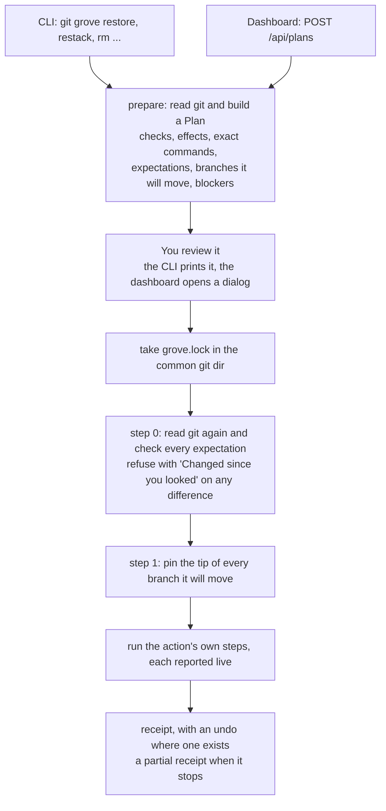

# git-grove: the written submission

The brief asked for a solution to a real problem I have had, explained in four parts: the problem, the system design,
the tradeoffs and the failure modes. This file is that explanation. [`README.md`](../README.md) has the install, the
two-minute demo and the commands. The full design spec, including the parts I cut, is
[`superpowers/specs/2026-11-01-git-grove-design.md`](superpowers/specs/2026-11-01-git-grove-design.md). Where the spec
and the code differ, the code is right, and this file describes the code.

## 1. Problem framing

### What happened

On a client project I keep 4–10 git worktrees open at once, several with AI coding agents working in them, and ship
features as stacks of small PRs. In two months, three things happened and nothing failed loudly:

- A stack branch went from 16 commits to 1 in a rebase nobody ran on purpose. Tests passed, the code was identical,
  and a reviewer only found it by reading the reflog.
- An agent's "clean up merged worktrees" pass removed 16 worktrees that were clean, pushed and merged, and deleted
  gitignored work that existed only inside them.
- A stacking tool was one command away from force-pushing branches from other features, because it saw every branch
  it had ever touched as one stack.

A fourth, reproduced while designing this: put one stack level's worktree inside another's folder, leave an
uncommitted file in the inner one, and a plain `git worktree remove` of the outer one (no `--force`) deletes both. Git
only refuses on changed or untracked files, and the inner folder is ignored.

### Why it is hard

1. Nothing fails. Git accepts every one of these operations. The signal is something missing, not an error.
2. The state is scattered: worktrees, refs, reflogs, stack metadata in git config, ignored files, stashes, PRs. No
   single command shows it.
3. "Clean" lies. `git status` says clean while the only copy of a seed file sits in an ignored folder.
4. Normal work looks like damage. Rebases and amends rewrite history too. Alarm on every rewrite and people stop
   reading. Telling a rebase from a squash is the real problem.
5. Agents act fast and in parallel. Full protection has to sit in the agent's path, before the command runs. git-grove
   catches the damage afterwards and keeps it recoverable, and its agent guard sits in Claude Code's path and stops
   the commands that would lose work before they run.

### What it is and is not

Tools like Conductor and Claude Squad help you start parallel work in worktrees. Nothing I found watches whether that
work is still intact. git-grove is a seatbelt, not an orchestrator: it watches on its own and changes git only when
you confirm a plan.

## 2. System design

### The parts

| Path | What it does |
|---|---|
| `src/core/git/run-git.ts` | The only code that runs git. Reads add `--no-optional-locks`; writes must say `write: true`. |
| `src/core/facts/` | What git says, with no judgment: `read-repo-facts.ts` for the whole repository and each worktree, `read-removal-facts.ts` for what deleting one worktree could lose. |
| `src/core/journal/` | `observe.ts` journals every branch tip change; `classify-tip-change.ts` decides what kind of change it was. |
| `src/core/stacks/` | Stacks read from gh-stack's git config (`stackparent`, `stackforkpoint`, plus grove's `grovefeature`); `is-merged.ts` decides "merged". |
| `src/core/rules/` | Ten rules in `registry.ts` turn facts and the journal into findings; `safe-to-remove.ts` is the removal verdict. |
| `src/core/runner/` | Pins (`pin.ts`), the per-repo lock (`with-repo-lock.ts`) and the restore that moves a branch back. |
| `src/core/actions/` | Eight actions (restore, ack, restack, new, add-level, copy-env, remove, cleanup) and `run-prepared.ts`, which runs any of them. |
| `src/core/guard/` | The agent guard: `read-simple-commands.ts` splits a shell line into simple commands, `classify-command.ts` decides what each needs checked, and `evaluate-command-line.ts` judges them in order and pins. |
| `src/core/guard-install/` | Installing the guard into Claude Code's settings: `plan-guard-install.ts` and `plan-guard-uninstall.ts` plan the new text, `write-settings-file.ts` re-reads, backs up and renames it into place. |
| `src/server/` | The local server: the gate (`auth/check-request.ts`), the watcher (`live/watch-repo.ts`), cached scans (`live/snapshots.ts`), live events (`live/hub.ts`) and previewed plans (`actions/plan-cache.ts`). |
| `ui/src/` | The dashboard: plain TypeScript, bundled by esbuild, with no runtime dependencies. |
| `src/cli/` | The commands. `run-guard.ts` is the hook's entry, which `bin.ts` loads without the rest of the CLI. |

State lives in two places. Pins are git refs (`refs/grove/pins/<branch>/<UTC time>`). The journal of tip changes,
acknowledgements and activity are in SQLite (`~/.git-grove/grove.db`, WAL mode, so the server and a CLI command can
write at once). Everything on screen is recomputed from git on each scan.

### One core behind every door

Every change grove makes goes through the same steps, whether it starts in the CLI or the dashboard:

An action is an `ActionDef` (`src/core/actions/action.types.ts`) whose `prepare` returns a `Plan` and an `execute`
closure. `runPrepared` (`src/core/actions/run-prepared.ts`) does the rest:

- a plan with blockers runs nothing and says "Not run";
- step 0 re-reads the repository under the lock and compares it with the plan's expectations: branch tips, pin refs,
  each worktree's HEAD, uncommitted files and any operation in progress;
- step 1 pins every branch in `moves`;
- the action's steps run; a step that fails stops the run, and steps never reached are reported as skipped;
- the receipt is recorded as activity. A run that stopped after moving something names what moved and offers undo
  for it.

The CLI runs the plan in its own process and exits 0 when done, 3 when the plan was blocked and 1 when it was refused
or stopped. The dashboard previews with `POST /api/plans`, runs with `POST /api/actions`, and streams the steps over
Server-Sent Events.

Every door shares this core so that the CLI and the dashboard cannot disagree about what is safe, and a fix to a
check lands everywhere at once. The same holds for findings: `status` and the dashboard's "Needs you" read the same
`readSnapshot` and the same rules. The agent guard calls the same removal verdict as `git grove check remove`
(`removalVerdict`, `src/core/facts/removal-verdict.ts`), so an agent is refused exactly what `check` would refuse.

### How grove tells a rebase from a squash

Every scan compares each branch tip with the last one it journaled (`src/core/journal/observe.ts`). A fast-forward is
"advanced" and needs nothing more. Any other move pins the old tip first, then `classifyTipChange` compares only the
branch's own commits:

1. Own range. The old commits are `<old base>..<old tip>` and the new ones `<new base>..<new tip>`, where the base is
   the merge base with the stack parent's tip, or with the trunk. Commits that belonged to the parent are never
   counted, so a child restacked after its parent was squash-merged is not a rewrite.
2. Patch ID. Each old commit is matched to a new one by `git patch-id --stable`. Every patch match is taken before any
   other kind.
3. Metadata. A commit still unmatched is matched by author email, author date and subject. This covers a rebase that
   resolved a conflict, where the patch changed.
4. A commit still unmatched is not lost when the new base gained a commit with its patch ID (it reached the trunk
   another way), or when it is a `fixup!` or `squash!` commit whose target matched only by metadata (it was folded in).

The result is amended (the base did not move, and only the tip commit changed), rebased (nothing lost) or rewritten
(the commits that are lost, with the pin that keeps them). Only a rewrite alerts. These tests pin it, in
`test/core/journal/classify-tip-change.test.ts`:

- "rebase onto moved main is rebased, every commit matched by patch"
- "rebase that resolved a conflict is rebased, the resolved commit matched by metadata"
- "a child restacked after its parent was squash-merged is rebased"
- "a commit cherry-picked to main and then dropped by a rebase onto main is rebased"
- "fixup! and squash! commits folded by --autosquash are not lost"
- "amending the tip with its message edited is amended"
- "squashing three commits into one is rewritten with all three lost"
- "dropping the middle commit is rewritten with that commit lost"
- "a fixup! commit dropped by rebase -i while its target stays is lost"

and, through the journal, "a squash after the baseline is one rewritten entry with three commits lost and a pin at
the old tip" in `test/core/journal/observe.test.ts`. While designing this I checked plain `git cherry` on a throwaway
repository: it reports a child restacked after its parent's squash merge as 2 changes lost. That check is recorded in
the spec (6.3), not in a test.

Deciding that a branch is merged, which drives "Parent merged", restack onto the trunk and the removal verdict, is a
separate check (`src/core/stacks/is-merged.ts`). A branch is merged when it is an ancestor of the trunk, or when
merging it into the trunk would leave the trunk's tree unchanged (`git merge-tree --write-tree`). Failing both, a
trunk commit must carry, byte for byte, the patch of all the branch's changes since the merge base
(`git patch-id --verbatim`, so whitespace counts), with no later trunk commit carrying its exact inverse. Tests in
`test/core/stacks/read-stack-facts.test.ts`: "a squash-merged branch stays merged after the trunk edits the same
lines", "a squash merge the trunk has since reverted is not merged", "a squash merge reverted, landed again and then
edited by the trunk is merged", "a whitespace-only change that differs from the trunk's is not merged".

### The removal verdict fails closed

`git grove check remove`, `rm` and the dashboard's cleanup all use `safeToRemove` (`src/core/rules/safe-to-remove.ts`).
A worktree is not safe when it has uncommitted or untracked files, commits that are neither pushed nor merged, commits
only its detached HEAD reaches, stashes for its branch, another worktree or git repository inside it, or an ignored
file with no byte-identical copy at the same path in the main worktree. A folder in main that leads back into a
worktree, through a symlink or a firmlink, is not a copy: folders are compared by `(dev, ino)`
(`src/core/facts/resolves-outside.ts`). A read that fails makes the verdict "unreadable", never "nothing found", and
more than 2,000 ignored files make it refuse as too many to check. Tests in `test/core/rules/safe-to-remove.test.ts`,
among them "a clean merged worktree holding .local/seed.sql is not safe", "a failed read is unreadable, never zero" and
"a main folder that is a symlink into the worktree is the same file seen twice, not a copy".

### The agent guard

Claude Code runs a `PreToolUse` hook before each Bash command, with the command and its folder as JSON on stdin.
`git grove guard --claude` answers it in four steps:

1. Read the line. `splitShellLine` and `readSimpleCommands` (`src/core/guard/`) split it on `&&`, `||`, `;`, `|` and
   newlines outside quotes, drop comments, redirections and here-document bodies, strip `VAR=value` and `env`, and
   follow the folder through `cd` and subshells; `parseGitCall` follows `git -C`. The commands inside `$( … )` and
   backticks are read too, and run first, so Claude Code's `"$(cat <<'EOF' … EOF)"` commit form is no obstacle. The
   exceptions are a `$( … )` inside `${…}`, a `$((…) )` subshell and a `$( … )` in an unquoted here-document body,
   which are not read (section 4). A command whose own paths or folder come from a variable, a substitution, a glob
   `cd` or a `GIT_DIR`-style prefix cannot be checked, nor can a whole line with `eval` or `bash -c` around `git` or
   `rm`, or a `case` inside a substitution; either is allowed, with one line saying so.
2. Classify each simple command from its words alone (`classifyCommand`): a worktree removal, a recursive `rm`, a
   discard of uncommitted changes, a `checkout` whose operands git must sort into a commit and paths, a command whose
   tips should be pinned, one of grove's people-only commands, or nothing.
3. Judge them in order; the first block wins. A worktree removal names its worktree the way git does, by a unique
   trailing folder name first, then by path (`findWorktree`), and asks `removalVerdict` about every worktree it would
   delete. A discard counts `git status --porcelain=v2 --untracked-files=no --ignore-submodules=all` entries in the
   paths it names; unmerged paths count only for a discard of the whole tree, so git's conflict tools stay usable on
   conflicted paths while `--ours`, `--theirs`, `-m` and `--conflict` on any other path are checked like any discard.
   During a merge, rebase, cherry-pick or revert, a whole-tree block names its `--abort`, and a path block says to
   name only the conflicted paths. Nothing is pinned until the whole
   line is allowed. Pins are taken without the repo lock: a pin only adds a ref, and `pin()` already copes with two
   processes creating one.
4. Fail open. Stdin that is not the hook's JSON, any error inside grove, and a check past 3 s allow the command, with
   one line on stderr; the deadline also stops the git calls still running.

A block exits 2 with what would be lost and the safe alternative, which Claude reads, and only then are blocks and
new pins written as activity rows, for repositories grove already knows, waiting at most 200 ms for the database.
`bin.ts` imports nothing statically and loads the guard by dynamic import; its imports never reach `src/server`,
`ui/`, `main.ts` or `node:sqlite` (`test/cli/guard-imports.test.ts`). Medians of 10 runs on the demo repository:
`ls` 40 ms and a blocked `git worktree remove` 145 ms on Node 24.11; 111 ms and 212 ms on Homebrew's Node 26, which
is slow to start.

Installing it is a review like any dashboard change. While the guard is missing from Claude Code's user settings
(`~/.claude/settings.json`, or `$CLAUDE_CONFIG_DIR/settings.json`), or points at an old Node or grove path, the
projects page offers it in a card, and the sidebar and ⌘K reach the same dialog. `src/core/guard-install/` parses the
file strictly, refuses one that is not a JSON object or whose `hooks.PreToolUse` is not a list, and plans the new text:
any grove hook is taken out and one group of grove's own is appended, never merged into a user's `Bash` group. The
dialog shows the file, its backup and the exact JSON. Confirming re-reads the file and refuses if its SHA-256 changed
since the review, copies it to `settings.json.grove-backup`, and renames a temp file with the old mode over it. Undo is
an uninstall planned against the file as it is then, so later edits survive. These routes change no repository, so
they take no repo lock and pin nothing (`src/server/api/guard-routes.ts`). Tests in
`test/core/guard-install/plan-guard-install.test.ts` and `test/server/guard-api.test.ts`, among them "installing
keeps every other setting and every other group, the user's own Bash group included, in order, and never merges into
it" and "the command an install writes, run by sh as Claude Code runs it, blocks removing the demo's precious worktree
with exit 2".

Tests in `test/core/guard/evaluate-command-line.test.ts`, among them "git worktree remove --force of a merged worktree
holding a precious ignored file is blocked", "git worktree remove of a worktree by its bare name, as git resolves it,
is blocked from the root", "the commands around and inside a substitution are checked, Claude Code's commit form
included", "git's conflict tools are allowed mid-merge: --ours, --theirs, -m and --conflict", "a discard mid-operation
is blocked with the abort that keeps your own changes", "git reset --hard HEAD~1 on a clean tree is allowed and pins
the old tip" and "git push --force origin feat pins the remote tip it would replace, under feat". The parser's are in
`test/core/guard/read-simple-commands.test.ts`.

### What makes a dashboard action safe to click

- The review shows the checks grove ran, what it will also do and the exact git commands.
- The confirm button arms 400 ms after the plan is painted (`ui/src/dialogs/dialog-host.ts`), it confirms only the
  plan id painted on it, and a repeated key event never confirms. Background re-previews pause while a dialog is open,
  so the plan on screen is the one that runs.
- The server keeps each previewed plan for 10 minutes under a random id, and a plan runs once: a second run is 409,
  an expired one 410, which makes the dialog preview again and show the new plan without running it.
- When it runs, step 0 refuses if anything the plan read has moved, step 1 pins first, and each ref move is a
  compare-and-swap: `git update-ref <ref> <new> <old>`, or, for a checked-out branch, a re-read of the tip just
  before `git reset --keep`.
- The dashboard and the CLI take the same `grove.lock`, so they cannot act on one repository at once. Background scans
  wait while it is held.
- Undo in a receipt prepares the undo as a new plan and opens it for review. It never runs anything you have not seen.

Tests: "a confirm before the arming delay is ignored, and a plan that replaces an armed one starts unarmed" and "a
confirm whose painted plan id is not the dialog's plan is ignored" (`test/ui/dialog-state.test.ts`); "a held Enter,
confirming again and again as the plan arrives, never runs a plan that was not armed"
(`test/ui/dialog-effects.test.ts`); "the same plan cannot run twice; an unknown plan is expired", "two tabs running
the same preview at once move the branch once", "a branch moved after the preview refuses the run and git is
unchanged" and "with the CLI holding the repo lock, the dashboard run is refused" (`test/server/actions-api.test.ts`).

### Why loopback and a header token, with no cookie

The server listens on `127.0.0.1` and `[::1]` only, answers only a `Host` of `127.0.0.1`, `[::1]` or `localhost` with
its port (which stops DNS rebinding), and needs the token from `~/.git-grove/token` in an `X-Grove-Token` header on
every API and event request. A POST also needs a same-origin `Origin` and `Sec-Fetch-Site` when the browser sends
them, and a JSON body. No response carries CORS headers, so a page on another origin cannot send that header.

The first version used a cookie. Cookies are scoped by host, not by port, so a cookie for `127.0.0.1` would be sent to
every server on `127.0.0.1:<any port>`, and holding it gave full control. So there is no cookie. `git grove ui` opens
`http://127.0.0.1:<port>/#token=<token>`; a fragment is never sent to any server. The page checks that the token is 64
lowercase hex characters, confirms it with one request, stores it in `localStorage` (scoped to the origin, port
included), and removes it from the address. A link carrying a bad token cannot sign the page out. Live updates are read
with `fetch` and a streaming body, because `EventSource` cannot send a header.

The accepted cost: a program that later listens on a port grove has served on can read that port's `localStorage`.
On a single-user machine that is accepted, and it is listed in the README. Tests: "no response sets a cookie", "a
rebound Host is 421, even with the token header" and "no response carries Access-Control-Allow-Origin"
(`test/server/start-server.test.ts`); "a token in the query string does not stand in for the header"
(`test/server/check-request.test.ts`); "a token the server refuses leaves the stored one in place"
(`test/ui/adopt-token.test.ts`).

### Finding out quickly

The dashboard server (`git grove serve`, kept running at login by a launchd agent or a systemd user unit) watches each
repository's git folder with `fs.watch`: refs, packed-refs, reflogs, each worktree's HEAD and index. It scans 300 ms
after the last change, or 2 s into a continuous burst, and every 30 s regardless. A scan journals, re-reads the
repository and evaluates the rules; the server then pushes a digest and any new activity to every open dashboard
over Server-Sent Events. A page asking for a view gets the cached scan, and a cache older than 2 s starts one
background refresh.

## 3. Tradeoffs

Each row: what I chose, over what, why, and what would change my mind.

| Decision | Instead of | Because | I'd change my mind if |
|---|---|---|---|
| Call the git CLI | a library (isomorphic-git, libgit2 bindings) | it behaves exactly like the user's git, worktrees and config included, and there is no native module to build | a scan of 100 worktrees took more than a second; then a long-lived `git cat-file --batch` and status cached by HEAD and index mtime |
| Pins as git refs | old tips stored in grove's database | the safety net survives grove's own bugs and a deleted database, and plain git can see it | pins grew into the thousands and slowed git; then `pins prune` (next) |
| Own commit range, then patch ID, then metadata | plain ancestry, or `git cherry` | ancestry alarms on every rebase; `git cherry` reported a restack as lost work | "Keep the squash" was needed more than a few times a week |
| Verbatim, revert-aware squash check | `merge-tree` alone | a squash merge the trunk later edited no longer merges cleanly, and a reverted one is not merged | wrong "merged" verdicts appeared; then also ask GitHub for the PR's state |
| Watch on its own, change git only on a confirmed plan | auto-restack and auto-clean | every incident was a tool acting on its own | plans ran clean dozens of times; then offer one-click runs for the boring ones |
| Re-check the plan when it runs, and refuse on any difference | run what was previewed | what you confirmed is what runs | refusals on harmless differences became common; then re-plan and show what changed |
| A login service, installed by the first `git grove ui` | a server only while the dashboard is open | rewrites happen while nobody is looking, and the watcher only helps if it is running | people objected to something running at login; then on-demand `ui` plus reflog catch-up |
| No cookie: token in the URL fragment, then `localStorage`, sent as a header | a session cookie | a cookie for `127.0.0.1` reaches every local server, whatever its port | the machine had several users; then a per-launch token and a fresh port |
| `fs.watch` with a debounce, plus a 30 s poll | polling only | a squash shows within a second or two, and the poll covers missed events and folders that cannot be watched | `fs.watch` proved unreliable on a platform; then a shorter poll there |
| `node:sqlite` in WAL mode | JSON files, or better-sqlite3 | the server and the CLI write at once; it is built in, so no native build | Node's SQLite API changed under us |
| Plain TypeScript and esbuild for the dashboard | React and Vite, as the spec suggested | zero runtime dependencies, one small bundle, and a CSP with no inline script or style | the dashboard grew past what hand-written rendering keeps tidy |
| The guard fails open | failing closed | a grove bug must never stop an agent's ordinary work: a crash, a git error and a check past 3 s all allow, with one line on stderr | the guard proved reliable; then fail closed for `worktree remove --force` and `push --force` only |
| grove writes Claude Code settings only after a review; it never merges into the user's own hook groups | printing a snippet to paste, or merging into the user's `Bash` group | installing should need no hand-editing; one group of grove's own, a strict parse that refuses what it cannot read, a re-read before writing, a backup and an atomic rename keep the write reversible, and Undo and Uninstall take out only grove's entry | a user's file is rewritten in a way they did not expect; then show a full diff, or write only through `install-guard --write` |
| The guard pins without the repo lock | taking `grove.lock` first | a pin only adds a ref, so the lock buys nothing, and holding it would make a dashboard action fail while an agent rebases | a guard pin raced another grove write in practice |

Smaller calls, each with its cost:

- `rm` re-checks the worktree right before `git worktree remove`. An ignored file written in the milliseconds between
  the two is lost.
- Repositories inside dependency and build folders (`node_modules`, `.venv` and the like) are not looked for, because
  walking them would blow the 2,000-file cap. An edited `pip install -e` clone under `.venv/src` can be removed with
  its local commits.
- `serve` takes over a server lock whose holder does not answer its health check within 1 s. If the holder is only
  slow, two servers run for about a second.
- `ui` rewrites the service file at grove's own path even when grove did not write it. A hand-edited unit there is
  replaced.
- Every scan runs `git status` in every worktree. It is simple and correct, and it is the first thing to cache when a
  repository has a hundred worktrees.

## 4. Failure modes

What grove does today when something goes wrong, and the test that shows it.

| What breaks | What grove does | Shown by |
|---|---|---|
| `grove.db` is deleted | No commit is lost: pins are refs, and `pins list` reads them from git. The journal starts again, so the next scan only records tips and open alerts are gone. `restore <branch>` without a pin ref then has no alert to say which pin you meant, so it lists the branch's pins and exits 3 until you name one. | `test/core/runner/pin.test.ts`, "listPins returns newest first and filters by branch"; `test/cli/commands.test.ts`, "restore with no pin named and no open alert is blocked and lists the pins, newest first, instead of guessing". No test deletes the database; I checked the rest by hand on the demo repository. |
| `grove.db` is corrupt, or grove's folder is unusable | Every command prints one line and exits 1, before it changes anything in git. | `test/cli/commands.test.ts`, "an unusable grove home or a corrupt grove.db exits 1 with one line" and "restore opens the store before it moves the branch" |
| A branch moved after you looked at the plan | The run refuses with "Changed since you looked". Nothing is pinned or moved. | `test/core/actions/run-prepared.test.ts`, "a branch that moves after the plan is refused and nothing changes" and "a branch that moves between the check and the move is refused and left where it is" |
| A plan stops halfway | A partial receipt names what moved and offers undo for it; steps never reached are shown as skipped. A restack keeps the levels it finished. | `test/core/actions/run-prepared.test.ts`, "a target that fails after an earlier one moved stops, names what moved and offers it as undo"; `test/core/actions/restack-action.test.ts`, "a conflict on level 03 stops there and keeps level 02 done" |
| A lock is left by a crash or a reboot | A repo lock naming a dead process, or written before the last boot, is taken over. Scans stop honouring a lock older than 15 minutes. | `test/core/runner/with-repo-lock.test.ts`, "a lock whose pid no longer runs is taken over" and "a lock written before the last boot is taken over even when its pid answers, as pid 1 does"; `test/server/lock-blocks-scan.test.ts`, "a lock older than 15 minutes does not block" |
| The server is down | A dashboard opened before loads from the service worker's cache and says "git grove isn't running. Start it with git grove ui." | `test/ui/sw-route.test.ts`, "a navigation to / is the page; other navigations go straight to the network"; `test/ui/api.test.ts`, "a rejected fetch becomes status 0 with "git grove isn't running"" |
| A key is held down on a review | Nothing confirms. Repeated key events are ignored, and confirm needs the plan armed. | `test/ui/keys.test.ts`, "a held key repeats no shortcut and no Enter; the palette's arrows still repeat"; `test/ui/dialog-effects.test.ts`, "a held Enter, confirming again and again as the plan arrives, never runs a plan that was not armed" |
| Two tabs, or the CLI and a tab, act at once | One plan runs once; the second actor is refused by the repo lock. | `test/server/actions-api.test.ts`, "two tabs running the same preview at once move the branch once" and "with the CLI holding the repo lock, the dashboard run is refused" |
| An agent is mid-rebase while grove scans or you act | Scans only read, with `--no-optional-locks`. Actions on that branch or worktree refuse and say why. | `test/core/git/run-git.test.ts`, "reads carry --no-optional-locks and writes do not"; `test/core/runner/restore.test.ts`, "restore refuses when the worktree holding the branch is mid-merge, and pins nothing" |
| A squash was deliberate, or the classifier is wrong | The alert stays until you restore the branch or keep the squash (`ack`); nothing changes in git. | `test/cli/commands.test.ts`, "ack dismisses a deliberate squash" |
| grove cannot read part of a worktree | The removal verdict says unreadable and refuses. | `test/core/rules/safe-to-remove.test.ts`, "a failed read is unreadable, never zero" and "an ignored file grove cannot inspect is unreadable, not skipped" |
| A rescued file changes after its copy was checked | The removal stops and the folder stays. | `test/core/actions/remove-actions.test.ts`, "E2: a rescued file edited after its copy was checked stops the removal, and the folder stays" |
| A watched repository's folder is deleted | It stays listed with its error; the other repositories carry on. | `test/server/hub.test.ts`, "a deleted repo folder publishes one scan-error and keeps the project listed" |
| `~/.claude/settings.json` changed after the review, or does not parse | The install is refused ("settings.json changed since the review; review again"), or never offered, and the file is not rewritten. | `test/core/guard-install/write-settings-file.test.ts`, "a file that changed since the plan read it is refused, and nothing is written"; `test/core/guard-install/plan-guard-install.test.ts`, "invalid JSON, a file that is not an object, a hooks that is not an object and a PreToolUse that is not a list are refused" |
| The guard itself crashes, cannot read its input, or is slow | It allows the command (exit 0) and prints one line: `git-grove guard: could not check (<reason>); allowing`. | `test/cli/guard-command.test.ts`, "an error thrown inside the evaluation is allowed, with a warning", "an evaluation past its deadline is allowed, with a warning", "garbage on stdin is allowed, with a warning" and "a cwd that is not a repository is allowed: plain commands silently, git ones with a warning"; `test/cli/guard-bin.test.ts`, "guard --claude exits 0 with one warning line for stdin it cannot read" |

What it does not handle yet:

- Rewrites while grove was off, beyond the tip diff. The server scans every repository when it starts, so with the
  login service such a change is found at login, or at the next `status`. That scan sees one move, from the last tip
  grove saved to the current one, and pins and classifies it. It does not read the reflog, so the steps in between
  are not seen, a branch it never saw has nothing to compare, the entry carries the time grove saw it rather than
  when it happened, and an old tip git has already pruned is replaced without an entry ("a last tip git no longer
  has is replaced without an entry", `test/core/journal/observe.test.ts`).
- Commands the guard does not see or check. It sees only what Claude Code runs through its Bash tool, so a script, a
  git alias, another agent or a terminal can still run `git worktree remove --force`, `rm -rf` on a worktree or
  `git reset --hard`, which destroy uncommitted and ignored files before any scan can see them. Through the guard,
  these still run unchecked:
  - `git clean -fdx`, `git stash drop` and `git stash clear`;
  - `git rm -f` of files with local changes;
  - wrappers the guard does not follow: `xargs rm -r`, `find … -delete`, `find … -exec rm -r`, `sudo`, `timeout`,
    `nice`, and git aliases, inline `git -c alias.x=…` included;
  - ref moves with no pin: `git branch -f`/`-M`, `git checkout -B`, `git switch -C`, `git rebase --update-refs`,
    `git pull --rebase`, `git update-ref -d`, `git reflog expire`, `git gc --prune=now`;
  - `rm -r` of a folder holding whole repositories, run from outside them, and `rm -rf .git`, which takes the pins
    with it;
  - commands bash runs from three places the reader skips: a `$((…) )` subshell, a `$( … )` inside `${…}` such as
    `${x:-$(…)}`, and a `$( … )` in an unquoted here-document body.

  A force push is pinned but not compared with the remote, and a detached HEAD gets no pin.
- Commits that only a detached HEAD held, once that HEAD moves on. The removal verdict and the prunable rule count
  them, but the journal follows branches only.

## 5. What's built and what's next

Built, with 1081 tests in 119 files (vitest against real temporary git repositories):

- the CLI: `status`, `restore`, `ack`, `pins list`, `check remove`, `new`, `add-level`, `restack`, `stack plan`,
  `rm [--rescue]`, `ui`, `serve`, `service install|uninstall|status`, `install-guard` and `guard --claude`;
- the agent guard: a Claude Code `PreToolUse` hook that blocks worktree removals and recursive `rm` that the removal
  verdict refuses, discards of uncommitted changes and grove's people-only commands, pins the tips that rebase,
  amend, `branch -D` and a force push could lose, and fails open; the dashboard installs it into Claude Code's user
  settings after a review, with a backup, Undo and Uninstall, and offers it in an onboarding card;
- the core: git facts in three tiers by cost (the whole repository, each worktree, and the removal checks), the
  journal and classifier, pins, restore, stacks from gh-stack config, the fail-closed removal verdict, ten rules and
  `ack`;
- eight actions on one plan, check, pin, run and receipt path;
- the local server with its watcher, live events and plan cache;
- the dashboard, with review dialogs, the ⌘K palette, live steps, receipts and Undo;
- the login service (launchd or systemd) and an installable web app;
- `scripts/demo.sh`, which reproduces the squash and the unsafe worktree in a temp folder, and shows the guard
  blocking an agent's removal of it.

Next, in order:

1. The guard's next checks: compare a force push with the remote and block one that drops commits, `git clean -fdx`,
   `git stash drop` and `clear`, the wrappers and ref moves listed in section 4, and say in the journal which agent
   session made a change.
2. Reflog catch-up at startup, marking what it finds as found later.
3. Status cached by each worktree's HEAD and index mtime, for repositories with a hundred worktrees.
4. GitHub data through `gh`: PR state and review threads.
5. `pins prune`, `rm --force`, `stack adopt`, `log`, and Windows.

## 6. Live round

**Engineer track: "add a small feature while sharing your screen".** Rehearse adding a rule end to end in under 10
minutes: a file in `src/core/rules/v1/`, one line in `src/core/rules/registry.ts`, a test in
`test/core/rules/rules.test.ts`. A finding at needs-action or worse shows in `status` and in the dashboard's Needs
you list with no other change. Candidates:

- `stale-stash`: a stash older than 7 days on a branch that has since merged.
- `no-upstream`: a branch with commits but no remote after 24 hours.
- `pins prune`: remove pins older than 30 days whose commits a branch or remote still reaches.

**"Why X instead of Y?"** Section 3 is the answer sheet.

**Tech-lead track, if that is the one:**

- "The client added a requirement" (say, Windows, or a team-wide view): show where it lands. Windows touches the git
  adapter's paths, process lookup for the locks and the login service. A read-only shared view would need the journal
  to leave the machine, which reopens the privacy decision.
- "The budget is cut in half": keep the classifier, pins, the removal verdict and the CLI; drop the dashboard in
  favour of `status --json`, then the login service.
